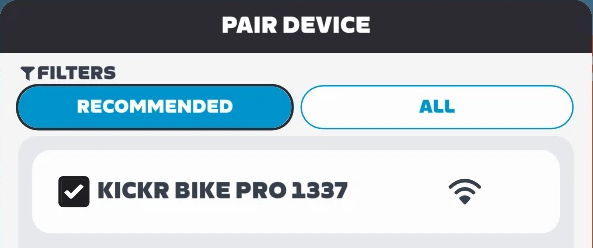
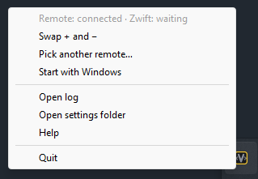

#  V-Steer

Steer in Zwift with a ThinkRider VS200 thumb remote: tap `+` to move right, `−` to move left.
Your other VS200 keeps shifting through the trainer as before.

## You need

- A Windows 10/11 PC with Bluetooth.
- A second VS200 that is **not** connected to the trainer.
- Zwift on this PC, or on another device on the same network.

## First run

1. Download `V-Steer.exe` from [Releases](https://github.com/valeraparafin/v-steer/releases/latest).
2. Run it. If Windows says it protected your PC, click **More info → Run anyway**.
   V-Steer has no window: its icon appears next to the clock (behind `^` if hidden).
3. If Windows Firewall asks, click **Allow** (Private networks is enough).
4. A notification asks you to press a button on the VS200: wake the steering remote and press
   any button. The app remembers this remote.
5. In Zwift: **Paired Devices → Controls** → pick **KICKR BIKE PRO 1337**.
   Zwift says "Welcome to steering".

   

6. Ride: `+` moves you one step right, `−` one step left.

To stop, right-click the icon → **Quit**.

## Every next ride

Run `V-Steer.exe` (or tick **Start with Windows** in its menu), then start Zwift.

- V-Steer started while Zwift is already open: Zwift pairs it by itself.
- V-Steer started first (e.g. with Windows): in Zwift, **Paired Devices → Controls** → pick
  **KICKR BIKE PRO 1337** once per ride; it is listed at once.
  Automatic pairing in this case is [being worked on](https://github.com/valeraparafin/v-steer/issues/10).

With no Zwift for 10 min, V-Steer lets the remote go so it can sleep and save its battery. After
pairing in Zwift, press any button on the remote once to wake it.

## The tray icon

| icon | means |
|------|-------|
|  | ready: the remote and Zwift are connected |
|  | one of them is connected; hover the icon to see which |
|  | neither is connected yet |
|  | V-Steer can't steer; **Open log** in the menu says why |

Hover the icon to see the remote's battery level (it is passed on to Zwift too); a notification
warns when it drops to 15%.

Right-click the icon for the menu: **Swap + and −**, **Pick another remote…**, **Start with
Windows**, **Open log**, **Open settings folder**, **Help** and **Quit**.

**Start with Windows** remembers where `V-Steer.exe` is: after moving it, untick and tick again.

## Updates

When a new version is out, a notification says so and the menu shows **Download**. Download the
new `V-Steer.exe` and replace the old one; your settings stay.

## Settings

Most settings are in the menu. The rest: **Open settings folder**, edit `config.toml` in Notepad,
then quit and start the app again.

| setting | default | what it does |
|---------|---------|--------------|
| `swap` | `false` | `true`: `+` steers left (menu: **Swap + and −**) |
| `pulse_ms` | `200` | how long one tap holds the steer (50..2000) |
| `address` under `[vs200]` | your remote | menu: **Pick another remote…** |
| `device_name` | `KICKR BIKE PRO 1337` | the name shown in Zwift |
| `address` under `[network]` | auto | your PC's LAN IP, if Zwift can't find the app |
| `check` under `[updates]` | `true` | `false` stops looking for new versions |

## Troubleshooting

- **Zwift doesn't list KICKR BIKE PRO 1337**: Windows may treat your home Wi-Fi as a Public
  network, where the app is blocked. Set it to Private (Settings → Network & internet → your
  network → Private network). Zwift and this PC must be on the same network. With a VPN on,
  disconnect it or set `[network] address`.
- **The remote isn't found**: press a button to wake it (it sleeps after ~30 min). It must not be
  connected to the trainer or another app.
- **See what the app is doing**: quit it from the tray, then start it with `--console`: the log
  shows in a window instead of the tray. In PowerShell: `& "C:\path\to\V-Steer.exe" --console`
  (or add ` --console` to a shortcut's target).
- **The antivirus deletes the exe**: this is a known false alarm for unsigned Python apps; restore
  it from quarantine or [report it](https://github.com/valeraparafin/v-steer/issues).

## Report a problem

[Open an issue](https://github.com/valeraparafin/v-steer/issues/new) and attach the log
(menu: **Open log**, or `%APPDATA%\V-Steer\v-steer.log`).

## What's next

Automatic pairing when Zwift starts after V-Steer, then more remotes and apps. See the
[milestones](https://github.com/valeraparafin/v-steer/milestones); ideas are welcome as
[issues](https://github.com/valeraparafin/v-steer/issues).

## More

- [How it works, running from source, building](docs/how-it-works.md)
- Credits: [ZwiftBridge](https://github.com/amirlagasse/ZwiftBridge) (MIT),
  [BikeControl](https://github.com/OpenBikeControl/bikecontrol). See [NOTICE](NOTICE).
- License: [MIT](LICENSE)
